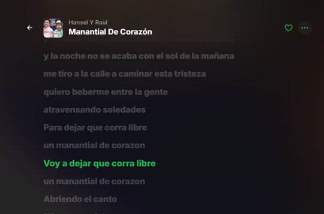
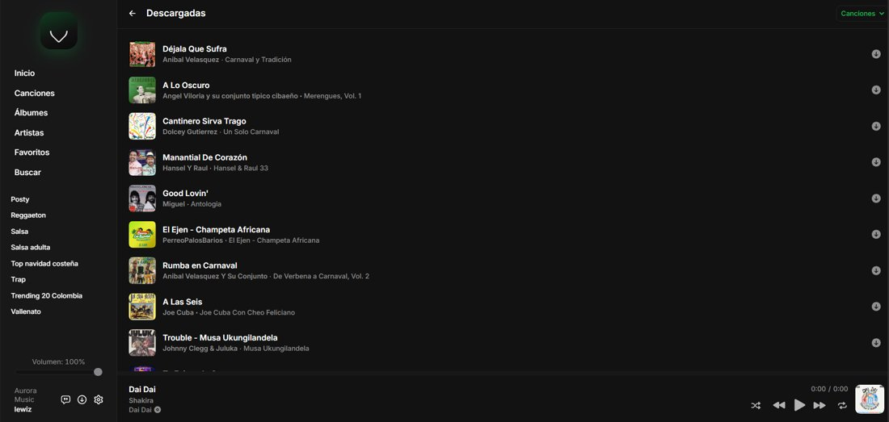

# Aurora Music

Un **reproductor de música para tu servidor Jellyfin**, con su propio **panel de administración** para gestionar los servidores y las listas. Tu familia entra con un **código de acceso** corto, su **usuario + contraseña** de Jellyfin, y escucha desde una app web pensada solo para la música.

- 🖥️ **Administrador de servidores**: registra uno o varios servidores Jellyfin en el panel y asígnales un código (`FAMILIA`, `CASA-2026`…). Nadie tiene que escribir ni recordar la URL del servidor, solo el código.
- 📋 **Administrador de listas**: importa listas de YouTube Music, empareja cada canción con tu biblioteca y crea la playlist en tu Jellyfin.
- 🚫📦 **No aloja ni almacena tu música**: los archivos y las bibliotecas viven en tu Jellyfin. Aurora se conecta a él mediante un *gateway* propio (API, carátulas y audio pasan por Aurora), pero no guarda el contenido del servidor: lo único que almacena es su propia configuración (servidores registrados, códigos, logos y ajustes).
- 📥 **Descargas offline en el cliente**: el audio que cada usuario descarga para escuchar sin conexión se guarda en su propio navegador o dispositivo, nunca en el servidor de Aurora.
- 🎨 **Temas con degradados** (Aurora, Spotify, Deezer, Apple Music, Ocean, Midnight, Forest…), sin logos de terceros.
- 🖼️ **Logos e imágenes propios** subidos desde el panel.
- 🇪🇸 **Español por defecto**, interruptor a inglés en Ajustes.
- 🔎 **Búsqueda dentro de la vista principal**, no en el menú lateral.

## Capturas

 



---

## 1. Arrancarlo en local (5 minutos)

Requisitos: Node 20+.

```bash
cd aurora
npm install

# 1) compilar la app web
npm run build

# 2) arrancar el servidor + panel
ADMIN_PASSWORD=unapasswordlarga SESSION_SECRET=cambiame-esto-por-algo-aleatorio npm run serve
```

- App: <http://localhost:8787>
- Panel: <http://localhost:8787/admin>

Si no defines `ADMIN_PASSWORD`, la primera vez se genera una y se imprime en la consola (solo una vez).

### Desarrollo (app + panel con recarga en caliente)

```bash
npm run dev:all
```

Arranca el servidor (`:8787`, con `--watch`) y Vite (`:5173`). Vite reenvía `/api`, `/jf`, `/admin` y `/branding` al servidor, así que tanto la app (<http://localhost:5173>) como el panel (<http://localhost:5173/admin>) funcionan desde el mismo origen. Usuario del panel `admin`, contraseña `admin1234` salvo que definas `ADMIN_PASSWORD`. Con `AURORA_SERVER=http://otro-host:puerto` apuntas Vite a otro servidor.

### Pruebas

```bash
npm test
```

Ejecutan el servidor real contra un Jellyfin simulado: login por código, gateway (JSON comprimido, audio con `Range`), panel (sesión, servidores, ajustes, logos) y arranque. No necesitan red ni un Jellyfin de verdad.

---

## 2. Configurar desde el panel

### a) Servidores y códigos
1. `Servidores y códigos` → pega la URL de tu servidor Jellyfin (ej: `https://jellyfin.micasa.com`).
2. Deja el **código** vacío para que se genere uno automático, o escribe el que quieras (`FAMILIA`, `CASA-2026`…).
3. **Prueba** para verificar conexión. Verás el nombre y la versión del servidor.

A partir de aquí tus familiares solo necesitan ese código y su usuario/contraseña.

> **Nota de seguridad**: la clave API es opcional y solo se usa en el panel para buscar en la biblioteca y crear listas. Para crear listas usa preferentemente la pestaña **Listas → Tu cuenta del servidor** (conecta tu usuario con permisos). El token se guarda en memoria del proceso, no en disco.

### b) Marca y logos
`Marca y logos` permite subir:
- **Logo principal** (login y menú lateral)
- **Logo para modo oscuro**
- **Icono de la app** (favicon + PWA)
- **Fondo del inicio de sesión**
- **Portada por defecto** y **imagen de artista** (sustituyen las genéricas)

Si no subes nada, se usan degradados del tema. Si una imagen falla, vuelve el degradado (nunca queda un hueco).

### c) Aspecto
Elige **tema por defecto**, **idioma por defecto** y si quieres ocultar la sección "About" de Ajustes (por defecto ya está oculta).

Cada usuario puede cambiar su tema e idioma en **Ajustes**.

---

## 3. Importar listas de YouTube Music

`Listas de YouTube Music`:

1. Conecta tu cuenta del servidor (usuario + contraseña con permiso para crear listas) o configura una clave API.
2. Pega el enlace de una playlist pública:
   `https://music.youtube.com/playlist?list=PLxxxxxxxx`
   (también acepta enlaces de canción y de álbum).
3. Pulsa **Leer y emparejar**. Se leen hasta 500 pistas y se busca cada una en tu biblioteca.
4. Revisa las que salen como **revisar** o **no encontrada** y elige a mano la versión correcta.
5. **Crear lista** → aparece en Jellyfin y por tanto en la app.

El emparejamiento puntúa título + artista + duración, ignora acentos, mayúsculas, `(Official Video)`, `feat.` y títulos truncados con `...`. Si el artista no coincide, **nunca** se marca como automático (evita karaokes y covers).

> Solo lee listas **públicas**. No descarga audio: empareja con lo que ya tienes en tu biblioteca.

---

## 4. Desplegarlo en un hosting gratuito

La app es un único proceso Node con estáticos + `/data`. Cualquier plataforma con contenedor o Node 20 sirve.

### Docker (lo más simple)

```bash
export ADMIN_PASSWORD='algo-largo-y-secreto'
export SESSION_SECRET="$(openssl rand -hex 32)"
docker compose up -d --build
```

Queda en `http://TU-IP:8787`. Los datos persisten en el volumen `aurora-data`.

### En la instancia gratuita de Oracle, junto a Jellyfin

Guía completa con HTTPS automático (Caddy), firewall y copias de seguridad: [`DEPLOY-ORACLE.md`](DEPLOY-ORACLE.md).

### En Fly.io

Contenedor con volumen persistente, ~4 USD/mes (la factura menor de 5 USD la perdonan): [`DEPLOY-FLY.md`](DEPLOY-FLY.md).

### Render / Railway (free tier)

> Ojo: el disco de Render gratis es efímero (se borra en cada reinicio), así que perderías códigos y logos. Detalles en [`DEPLOY-FLY.md`](DEPLOY-FLY.md).

1. Sube este repo a tu GitHub.
2. Crea un **Web Service** apuntando al repo.
3. Build command: `npm install --legacy-peer-deps && npm run build`
   Start command: `node server/src/index.js`
4. Variables de entorno:
   - `ADMIN_PASSWORD` (obligatorio)
   - `SESSION_SECRET` (obligatorio, cadena aleatoria larga)
   - `DATA_DIR=/data`
5. **Disco persistente** (importante): monta un volumen de 1 GB en `/data`. Sin él, los códigos y logos se pierden en cada redeploy.

> En free tiers el contenedor se duerme: la primera visita tarda unos segundos en despertar. A cambio, tus familiares entran siempre por la URL de tu Aurora.

### En tu propio servidor con Node (systemd + Caddy/Nginx)

Esta es la vía para un VPS o una máquina en casa. No hace falta Docker.

**1. Copia el proyecto y compila**

```bash
git clone https://github.com/TU-USUARIO/aurora-music.git
cd aurora-music
npm ci --legacy-peer-deps        # instala web + servidor (postinstall)
npm run build                    # genera /dist
```

**2. Crea el archivo de entorno**

```bash
sudo mkdir -p /etc/aurora /var/lib/aurora
sudo tee /etc/aurora/aurora.env >/dev/null <<'ENV'
NODE_ENV=production
PORT=8787
DATA_DIR=/var/lib/aurora
ADMIN_USER=admin
ADMIN_PASSWORD=CAMBIA-ESTA-CONTRASENA
SESSION_SECRET=CAMBIA-ESTA-CADENA-POR-64-CARACTERES-ALEATORIOS
ENV
sudo chmod 600 /etc/aurora/aurora.env
```

Genera el secreto con `openssl rand -hex 32`.

**3. Servicio systemd** (`/etc/systemd/system/aurora.service`)

```ini
[Unit]
Description=Aurora Music
After=network.target

[Service]
Type=simple
User=aurora
WorkingDirectory=/opt/aurora-music
EnvironmentFile=/etc/aurora/aurora.env
ExecStart=/usr/bin/node server/src/index.js
Restart=always
RestartSec=3
NoNewPrivileges=true
PrivateTmp=true

[Install]
WantedBy=multi-user.target
```

```bash
sudo useradd -r -s /usr/sbin/nologin aurora || true
sudo mkdir -p /opt && sudo cp -r aurora-music /opt/
sudo chown -R aurora:aurora /opt/aurora-music /var/lib/aurora
sudo systemctl daemon-reload
sudo systemctl enable --now aurora
sudo systemctl status aurora        # y logs: journalctl -u aurora -f
```

**4. HTTPS con Caddy** (gratis y automático)

```
music.tudominio.com {
    reverse_proxy 127.0.0.1:8787
}
```

Con Nginx: `proxy_pass http://127.0.0.1:8787;` y `proxy_set_header Host $host;`. No actives caché para `/jf/` (audio y carátulas ya van autenticados).

**5. Actualizar**

```bash
cd /opt/aurora-music && git pull && npm ci --legacy-peer-deps && npm run build && sudo systemctl restart aurora
```

> El proceso sólo escribe en `DATA_DIR` (códigos, logos, ajustes). Haz copia de esa carpeta: es todo el estado.

### Con PM2 (alternativa rápida, sin systemd)

```bash
npm i -g pm2
ADMIN_PASSWORD=... SESSION_SECRET=... pm2 start server/src/index.js --name aurora
pm2 save && pm2 startup
```

### Con dominio propio y HTTPS

Pon el contenedor detrás de Caddy/Cloudflare Tunnel y listo:

```
music.tudominio.com {
    reverse_proxy localhost:8787
}
```

Los archivos listos para copiar están en [`deploy/`](deploy/): `aurora.service`, `Caddyfile`, `nginx.conf` y `aurora.env.example`.

---

## 5. Qué cambia respecto al proyecto original

| Área | Antes | Ahora |
|---|---|---|
| Login | URL del servidor + usuario | **Código** + usuario + contraseña (la URL del servidor se configura una sola vez en el panel) |
| Red | Llamadas directas al servidor | **Gateway** `/jf/<token>` cifrado (AES-GCM): la app habla con Aurora y Aurora con tu Jellyfin |
| Credenciales | Token en `localStorage` y en la URL de cada imagen/stream | Token de gateway opaco + `Authorization` header, sin secretos en URLs |
| Temas | Claro/oscuro | **9 temas con degradados** + claro/oscuro/sistema |
| Marca | Logo fijo del proyecto | **Logos propios** desde el panel, favicon dinámico |
| Idiomas | Inglés | **Español** (por defecto) + inglés |
| Búsqueda | En el sidebar | **En la vista principal** (`/search`, Ctrl/⌘+K) |
| Youtube Music | — | **Importador** con emparejamiento y revisión manual |
| About/GitHub | Visible | Eliminado; sin llamadas a la API de GitHub |
| Bundle inicial | 411 kB gzip en un solo archivo | **~150 kB gzip** (rutas en lazy + hls.js bajo demanda) |
| Fuentes | 929 kB (21 archivos) | **48 kB** (solo latin) |
| PWA | Precarga 4.5 MB, sin fallback offline | Precarga ligera, `navigateFallback`, no cachea audio/carátulas |
| Lint | Roto (TS 7 vs typescript-eslint) | **Funciona**: 0 errores (TS 6) |

### Lo que NO cambia
Sigue siendo el mismo reproductor: descargas offline, crossfade, precarga, letras sincronizadas, cola, instant mix, PWA y app de escritorio.

---

## 6. Estructura

```
aurora/
├── src/                  # app web (React + Vite + TS)
│   ├── api/gateway.ts    # login por código contra el gateway
│   ├── config/           # configuración de marca que sirve el backend
│   ├── i18n/             # español / inglés
│   ├── theme/            # catálogo de temas y aplicación de variables
│   └── pages/Search.tsx  # buscador en la vista principal
├── server/               # Node + Express
│   ├── src/index.js      # arranque, /api/app-config, estáticos
│   ├── src/proxy.js      # gateway transparente + login por código
│   ├── src/admin.js      # API del panel (servidores, logos, importaciones)
│   ├── src/ytmusic.js    # lector de YouTube Music (InnerTube)
│   ├── src/match.js      # emparejamiento título/artista/duración
│   └── admin/index.html  # panel, un solo archivo, sin dependencias
└── Dockerfile
```

---

## 7. Variables de entorno

| Variable | Obligatoria | Descripción |
|---|---|---|
| `ADMIN_PASSWORD` | sí | Contraseña del panel. Si cambia, se actualiza la guardada al reiniciar (junto con `ADMIN_USER`) |
| `SESSION_SECRET` | sí en producción | Firma y cifra las sesiones del gateway |
| `SANDBOX_ORIGIN` | no | `1` permite usar la app y el panel dentro de un iframe de otro origen (vistas previas). Por defecto sólo se permite el mismo origen |
| `FRAME_ANCESTORS` | no | Lista CSP de orígenes que pueden incrustar la app. Por defecto `'self' https: http:` |
| `ADMIN_USER` | no | Usuario del panel (por defecto `admin`) |
| `LOGIN_MAX_FAILURES` | no | Intentos fallidos por IP antes de responder 429 en el panel y en el login por código (por defecto `10`) |
| `LOGIN_WINDOW_MS` | no | Ventana de esos intentos en milisegundos (por defecto `900000`, 15 min) |
| `TRUST_PROXY` | no | Proxies inversos delante: nº de saltos (por defecto `1`), `0`/`false` ninguno, o lista de IPs/CIDR. Determina la IP real para el límite de intentos |
| `PORT` | no | Puerto (por defecto `8787`) |
| `DATA_DIR` | no | Carpeta de datos (por defecto `server/data`) |
| `WEB_DIR` | no | Carpeta del build web (por defecto `dist`) |

---

## 8. Límites y cosas a saber

- El gateway **no** es un CDN ni un almacén: el audio fluye desde tu Jellyfin a través de Aurora, sin guardarse en ella. Con 4–5 familiares va sobrado; para 50 usa un VPS pequeño.
- Las listas de YouTube Music se leen sin cuenta: solo funcionan con playlists públicas (las privadas requieren OAuth, que no está implementado).
- Los códigos se pueden cambiar o desactivar en cualquier momento desde el panel; el cambio aplica al siguiente login.
- Las descargas offline se guardan solo en el cliente de cada usuario (su navegador o dispositivo), nunca en el servidor de Aurora.

---

Hecho sobre [Jelly Music App](https://github.com/Stannnnn/jelly-app) (MIT). Esta versión mantiene la licencia MIT del original.
